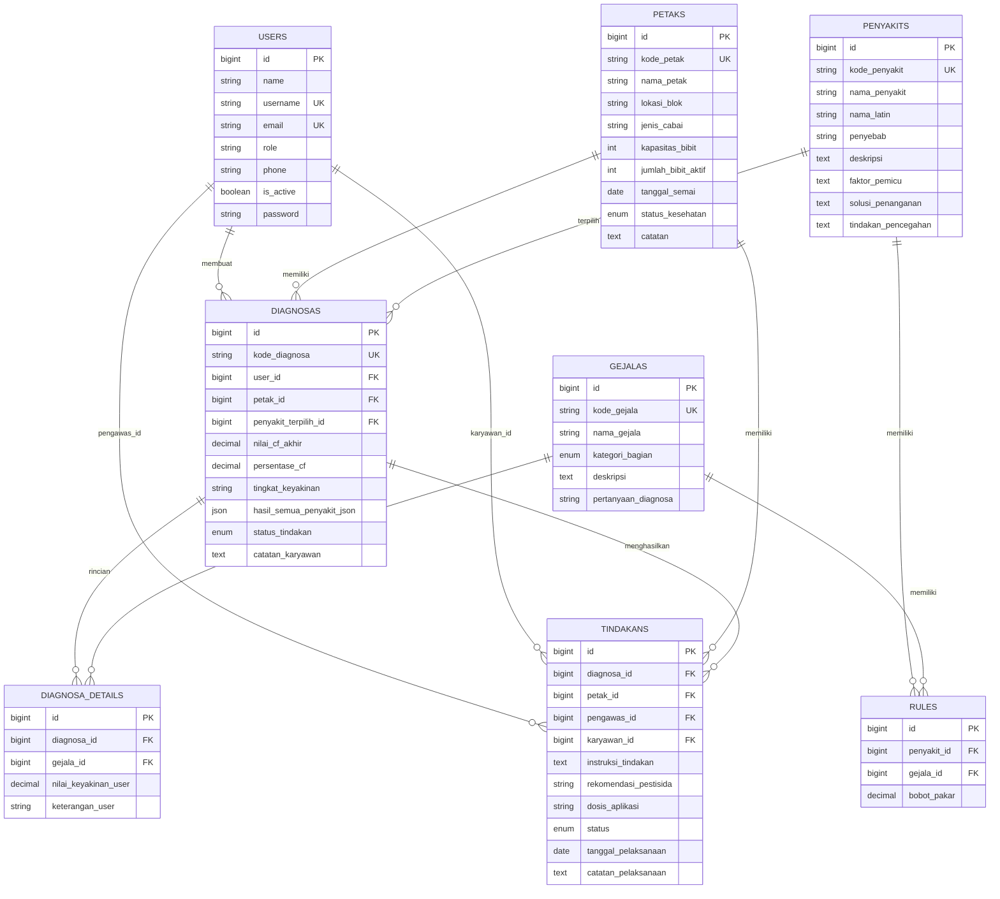

# Dokumentasi Sistem

## Sistem Pakar Diagnosa Penyakit Bibit Cabai — Helly Seedling

| Item | Keterangan |
|---|---|
| Nama sistem | Sistem Pakar Helly Seedling |
| Jenis aplikasi | Aplikasi web (sistem pakar + manajemen persemaian) |
| Metode inferensi | Certainty Factor (CF) |
| Framework | Laravel 11 (PHP ^8.2) |
| Basis data | MySQL `sp_hellyseedling_cf` |
| Frontend | Blade + Tailwind CSS + Alpine.js + Chart.js |
| Versi dokumen | 1.0 |
| Terakhir diperbarui | 6 November 2026 |

---

## Daftar Isi

1. [Ringkasan Sistem](#1-ringkasan-sistem)
2. [Tujuan dan Manfaat](#2-tujuan-dan-manfaat)
3. [Teknologi yang Digunakan](#3-teknologi-yang-digunakan)
4. [Arsitektur Aplikasi](#4-arsitektur-aplikasi)
5. [Peran Pengguna dan Hak Akses](#5-peran-pengguna-dan-hak-akses)
6. [Alur Kerja Sistem](#6-alur-kerja-sistem)
7. [Metode Certainty Factor](#7-metode-certainty-factor)
8. [Struktur Basis Data](#8-struktur-basis-data)
9. [Struktur Direktori Penting](#9-struktur-direktori-penting)
10. [Daftar Route dan Halaman](#10-daftar-route-dan-halaman)
11. [Panduan Instalasi dan Menjalankan](#11-panduan-instalasi-dan-menjalankan)
12. [Akun Demo dan Data Awal](#12-akun-demo-dan-data-awal)
13. [Aturan Bisnis](#13-aturan-bisnis)
14. [Catatan Teknis dan Batasan](#14-catatan-teknis-dan-batasan)

---

## 1. Ringkasan Sistem

Helly Seedling adalah aplikasi web yang digunakan untuk:

1. Mencatat data **petak semai** (bedengan persemaian bibit cabai).
2. Mendiagnosa **penyakit bibit cabai** berdasarkan gejala yang diamati, menggunakan perhitungan **Certainty Factor**.
3. Menyimpan **riwayat diagnosa** beserta rincian perhitungan.
4. Mengelola **instruksi tindakan penanganan** dari pengawas/pakar kepada karyawan.
5. Menyajikan **laporan dan statistik** sebaran penyakit.

Sistem membedakan dua peran: **Pengawas/Pakar** (hak penuh) dan **Karyawan** (konsultasi dan pelaksanaan tindakan).

---

## 2. Tujuan dan Manfaat

- Mempercepat identifikasi penyakit bibit cabai tanpa harus menunggu pemeriksaan pakar.
- Menstandarkan bobot keyakinan pakar ke dalam basis aturan yang dapat dikelola.
- Mendokumentasikan riwayat diagnosa dan tindakan secara terpusat.
- Menyediakan data statistik untuk pengambilan keputusan pengendalian penyakit di persemaian.

---

## 3. Teknologi yang Digunakan

| Lapisan | Teknologi |
|---|---|
| Bahasa | PHP 8.2 |
| Framework | Laravel 11 |
| ORM | Eloquent |
| Database | MySQL (utf8mb4) |
| Template | Blade |
| CSS | Tailwind CSS (CDN) |
| Interaksi UI | Alpine.js |
| Grafik | Chart.js |
| Notifikasi | SweetAlert2 |
| Ikon | Lucide Icons |
| Build tool | Vite (opsional, aset utama via CDN) |
| Pengujian | PHPUnit 10.5 |

Dependensi utama dapat dilihat pada `composer.json`.

---

## 4. Arsitektur Aplikasi

Sistem mengikuti pola **MVC** dengan tambahan **Service Layer** untuk mesin inferensi.

```
Request HTTP
    │
    ▼
routes/web.php
    │
    ▼
Controller (app/Http/Controllers)
    │        │
    │        └──► CertaintyFactorService (app/Services)
    │                    │
    ▼                    ▼
Model (Eloquent) ───► Database MySQL
    │
    ▼
View (resources/views, Blade)
    │
    ▼
Response HTML
```

Komponen penting:

- **Routing** — `routes/web.php`
- **Middleware role** — `app/Http/Middleware/RoleMiddleware.php`, alias `role` didaftarkan di `bootstrap/app.php`
- **Mesin CF** — `app/Services/CertaintyFactorService.php`
- **Controller** — `app/Http/Controllers/*`
- **Model** — `app/Models/*`
- **View** — `resources/views/*`

---

## 5. Peran Pengguna dan Hak Akses

### 5.1 Pengawas / Pakar

- Melihat dashboard statistik seluruh persemaian.
- CRUD petak semai.
- CRUD master penyakit.
- CRUD master gejala.
- CRUD basis aturan (rule) beserta bobot pakar.
- CRUD akun karyawan.
- Membuat instruksi tindakan.
- Melihat seluruh riwayat diagnosa.
- Menghapus arsip diagnosa.
- Mengakses dan mencetak laporan.

### 5.2 Karyawan

- Melakukan konsultasi/diagnosa pada petak.
- Melihat riwayat diagnosa **miliknya sendiri**.
- Melihat daftar petak dan detailnya.
- Melihat ensiklopedia penyakit dan gejala.
- Melihat tindakan yang ditugaskan kepadanya.
- Memperbarui status pelaksanaan tindakan.

### 5.3 Matriks Hak Akses

| Fitur | Pengawas | Karyawan |
|---|:---:|:---:|
| Login / logout | ✅ | ✅ |
| Dashboard | ✅ | ✅ |
| Konsultasi diagnosa | ✅ | ✅ |
| Riwayat diagnosa | Semua | Milik sendiri |
| Hapus diagnosa | ✅ | ❌ |
| Lihat petak | ✅ | ✅ |
| Kelola petak (CRUD) | ✅ | ❌ |
| Lihat penyakit/gejala | ✅ | ✅ |
| Kelola penyakit/gejala/rule | ✅ | ❌ |
| Lihat tindakan | Semua | Milik sendiri |
| Buat instruksi tindakan | ✅ | ❌ |
| Update status tindakan | ✅ | ✅ |
| Kelola akun karyawan | ✅ | ❌ |
| Laporan & cetak | ✅ | ❌ |

---

## 6. Alur Kerja Sistem

### 6.1 Alur Konsultasi / Diagnosa

```
Karyawan login
    │
    ▼
Pilih petak semai
    │
    ▼
Pilih gejala + tingkat keyakinan (0.0 – 1.0)
    │
    ▼
POST /diagnosa
    │
    ▼
CertaintyFactorService::diagnose()
    │
    ├── Hitung CF tiap gejala: CF(user) × CF(pakar)
    ├── Kombinasikan: CF_lama + CF_baru × (1 − CF_lama)
    ├── Urutkan penyakit berdasarkan CF akhir
    └── Tentukan predikat keyakinan
    │
    ▼
Simpan diagnosa + detail gejala
    │
    ▼
Update status kesehatan petak otomatis
    │
    ▼
Tampilkan hasil diagnosa
```

### 6.2 Alur Tindakan Penanganan

```
Hasil diagnosa
    │
    ▼
Pengawas membuat instruksi tindakan
(instruksi, pestisida, dosis, karyawan)
    │
    ▼
Status diagnosa → "diproses"
    │
    ▼
Karyawan mengerjakan
    │
    ├── status "menunggu"
    ├── status "sedang_dikerjakan"
    └── status "selesai"
             │
             ▼
      Status diagnosa → "selesai"
      Petak "terinfeksi" → "waspada"
```

### 6.3 Alur Pelaporan

```
Pilih rentang tanggal / petak / penyakit
    │
    ▼
LaporanController::index()
    │
    ├── Daftar diagnosa terfilter
    ├── Statistik penyakit terbanyak
    └── Statistik kasus per petak
    │
    ▼
Tampilkan / cetak (/laporan/cetak)
```

---

## 7. Metode Certainty Factor

### 7.1 Konsep

Certainty Factor menyatakan tingkat keyakinan terhadap suatu hipotesis (penyakit) berdasarkan bukti (gejala). Setiap gejala memiliki:

- **CF user** — keyakinan pengguna saat mengamati gejala.
- **CF pakar** — bobot keyakinan pakar bahwa gejala tersebut mengindikasikan penyakit tertentu.

Nilai CF berada pada rentang `0.0` sampai `1.0`.

### 7.2 Skala Keyakinan Pengguna

| Nilai | Label |
|---|---|
| 1.00 | Sangat Yakin (1.0) |
| 0.80 | Yakin (0.8) |
| 0.60 | Cukup Yakin (0.6) |
| 0.40 | Sedikit Ragu (0.4) |
| 0.00 | Tidak Yakin (0.0) |

Gejala dengan nilai `0.00` tidak diikutkan dalam perhitungan.

### 7.3 Rumus

**CF untuk satu gejala:**

```
CF(H,E) = CF(user) × CF(pakar)
```

**Kombinasi dua nilai CF:**

```
CF_combine = CF_lama + CF_baru × (1 − CF_lama)
```

**Persentase akhir:**

```
Persentase = CF_akhir × 100
```

### 7.4 Predikat Tingkat Keyakinan

| Persentase | Predikat |
|---|---|
| ≥ 85.00% | Sangat Yakin / Akurat Tinggi |
| ≥ 70.00% | Yakin / Kemungkinan Besar |
| ≥ 50.00% | Cukup Yakin / Terindikasi |
| ≥ 30.00% | Kurang Yakin / Gejala Awal |
| < 30.00% | Sangat Rendah / Belum Cukup Bukti |

### 7.5 Contoh Perhitungan

Kasus: penyakit **P01 — Rebah Semai (Damping Off)** dengan gejala terpilih:

| Gejala | CF User | Bobot Pakar | CF Gejala |
|---|---:|---:|---:|
| G01 | 1.00 | 0.95 | 0.9500 |
| G02 | 0.80 | 0.85 | 0.6800 |
| G12 | 0.80 | 0.80 | 0.6400 |

Langkah:

1. `CF₁ = 1.00 × 0.95 = 0.9500`
2. `CF₂ = 0.80 × 0.85 = 0.6800`
   `Kombinasi = 0.9500 + 0.6800 × (1 − 0.9500) = 0.9840`
3. `CF₃ = 0.80 × 0.80 = 0.6400`
   `Kombinasi = 0.9840 + 0.6400 × (1 − 0.9840) = 0.9942`

Hasil akhir: **CF = 0.9942 → 99.42% → "Sangat Yakin / Akurat Tinggi"**.

### 7.6 Keluaran Mesin CF

`CertaintyFactorService::diagnose()` mengembalikan:

```php
[
    'status' => 'success',
    'best_disease' => [ ... ],
    'ranked_diseases' => [
        [
            'penyakit_id' => 1,
            'kode_penyakit' => 'P01',
            'nama_penyakit' => 'Rebah Semai (Damping Off)',
            'cf_final' => 0.9942,
            'persentase' => 99.42,
            'confidence_level' => 'Sangat Yakin / Akurat Tinggi',
            'matched_count' => 3,
            'total_rules' => 4,
            'symptom_breakdowns' => [ ... ],
            'cf_steps' => [ ... ],
        ],
        // penyakit lain terurut menurun
    ],
]
```

Jika tidak ada gejala dengan bobot > 0, status yang dikembalikan adalah `no_symptoms`.

---

## 8. Struktur Basis Data

### 8.1 Entity Relationship Diagram



### 8.2 Keterangan Tabel

| Tabel | Fungsi |
|---|---|
| `users` | Akun pengguna dengan role `pengawas` atau `karyawan` |
| `petaks` | Data petak/bedengan semai dan status kesehatannya |
| `penyakits` | Master penyakit bibit cabai |
| `gejalas` | Master gejala, dikelompokkan per bagian tanaman |
| `rules` | Basis aturan penyakit–gejala beserta bobot pakar |
| `diagnosas` | Header hasil konsultasi |
| `diagnosa_details` | Gejala yang dipilih pada suatu konsultasi |
| `tindakans` | Instruksi penanganan dan status pelaksanaannya |

### 8.3 Nilai Enum

| Kolom | Nilai |
|---|---|
| `users.role` | `pengawas`, `karyawan` |
| `petaks.status_kesehatan` | `sehat`, `waspada`, `terinfeksi`, `kosong` |
| `gejalas.kategori_bagian` | `daun`, `batang`, `akar`, `bibit_umum` |
| `diagnosas.status_tindakan` | `menunggu`, `diproses`, `selesai` |
| `tindakans.status` | `menunggu`, `sedang_dikerjakan`, `selesai` |

### 8.4 Aturan Relasi dan Integritas

- `rules` memiliki `unique(penyakit_id, gejala_id)` — satu pasangan penyakit–gejala hanya boleh sekali.
- Hapus penyakit/gejala → rule terkait ikut terhapus (`cascade`).
- Hapus user/petak/diagnosa → data turunannya ikut terhapus (`cascade`).
- `penyakit_terpilih_id` pada diagnosa bernilai `null` jika penyakit dihapus (`set null`).
- `karyawan_id` pada tindakan bernilai `null` jika akun karyawan dihapus (`set null`).

---

## 9. Struktur Direktori Penting

```
UTS/
├── app/
│   ├── Http/
│   │   ├── Controllers/
│   │   │   ├── AuthController.php
│   │   │   ├── DashboardController.php
│   │   │   ├── DiagnosaController.php
│   │   │   ├── GejalaController.php
│   │   │   ├── KaryawanController.php
│   │   │   ├── LaporanController.php
│   │   │   ├── PenyakitController.php
│   │   │   ├── PetakController.php
│   │   │   ├── RuleController.php
│   │   │   └── TindakanController.php
│   │   └── Middleware/
│   │       └── RoleMiddleware.php
│   ├── Models/
│   │   ├── Diagnosa.php
│   │   ├── DiagnosaDetail.php
│   │   ├── Gejala.php
│   │   ├── Penyakit.php
│   │   ├── Petak.php
│   │   ├── Rule.php
│   │   ├── Tindakan.php
│   │   └── User.php
│   └── Services/
│       └── CertaintyFactorService.php
├── bootstrap/app.php
├── database/
│   ├── migrations/
│   │   ├── 0001_01_01_000000_create_users_table.php
│   │   └── 2026_10_29_215950_create_helly_seedling_tables.php
│   └── seeders/
│       ├── DatabaseSeeder.php
│       └── HellySeedlingSeeder.php
├── resources/views/
│   ├── auth/
│   ├── dashboard/
│   ├── diagnosa/
│   ├── gejalas/
│   ├── karyawan/
│   ├── laporan/
│   ├── layouts/app.blade.php
│   ├── penyakits/
│   ├── petaks/
│   ├── rules/
│   └── tindakans/
├── routes/web.php
├── .env
└── composer.json
```

---

## 10. Daftar Route dan Halaman

### 10.1 Autentikasi

| Method | URI | Nama Route | Keterangan |
|---|---|---|---|
| GET | `/` | — | Redirect ke dashboard/login |
| GET | `/login` | `login` | Form login |
| POST | `/login` | `login.post` | Proses login |
| POST | `/logout` | `logout` | Logout |
| GET | `/quick-login/{role}` | `quick.login` | Login demo berdasarkan role |

### 10.2 Area Terautentikasi (semua role)

| Method | URI | Nama Route | Keterangan |
|---|---|---|---|
| GET | `/dashboard` | `dashboard` | Dashboard dinamis per role |
| GET | `/diagnosa` | `diagnosa.index` | Riwayat diagnosa |
| GET | `/diagnosa/mulai` | `diagnosa.create` | Form konsultasi |
| POST | `/diagnosa` | `diagnosa.store` | Proses diagnosa |
| GET | `/diagnosa/{diagnosa}` | `diagnosa.show` | Detail hasil diagnosa |
| DELETE | `/diagnosa/{diagnosa}` | `diagnosa.destroy` | Hapus (pengawas) |
| GET | `/petaks` | `petaks.index` | Daftar petak |
| GET | `/petaks/{petak}` | `petaks.show` | Detail petak |
| GET | `/penyakits` | `penyakits.index` | Ensiklopedia penyakit |
| GET | `/penyakits/{penyakit}` | `penyakits.show` | Detail penyakit |
| GET | `/tindakans` | `tindakans.index` | Daftar tindakan |
| PATCH | `/tindakans/{tindakan}/status` | `tindakans.update-status` | Update status tindakan |

### 10.3 Area Khusus Pengawas

| Method | URI | Nama Route | Keterangan |
|---|---|---|---|
| GET | `/petaks-baru` | `petaks.create` | Form tambah petak |
| POST | `/petaks` | `petaks.store` | Simpan petak |
| GET | `/petaks/{petak}/edit` | `petaks.edit` | Form edit petak |
| PUT | `/petaks/{petak}` | `petaks.update` | Update petak |
| DELETE | `/petaks/{petak}` | `petaks.destroy` | Hapus petak |
| GET | `/penyakits-baru` | `penyakits.create` | Form tambah penyakit |
| POST | `/penyakits` | `penyakits.store` | Simpan penyakit |
| GET | `/penyakits/{penyakit}/edit` | `penyakits.edit` | Form edit penyakit |
| PUT | `/penyakits/{penyakit}` | `penyakits.update` | Update penyakit |
| DELETE | `/penyakits/{penyakit}` | `penyakits.destroy` | Hapus penyakit |
| — | `/gejalas` | `gejalas.*` | Resource CRUD gejala |
| GET | `/rules` | `rules.index` | Daftar basis aturan |
| POST | `/rules` | `rules.store` | Tambah rule |
| PUT | `/rules/{rule}` | `rules.update` | Update bobot rule |
| DELETE | `/rules/{rule}` | `rules.destroy` | Hapus rule |
| — | `/karyawan` | `karyawan.*` | Resource CRUD akun karyawan |
| GET | `/tindakans-baru` | `tindakans.create` | Form instruksi tindakan |
| POST | `/tindakans` | `tindakans.store` | Simpan instruksi |
| GET | `/laporan` | `laporan.index` | Laporan statistik |
| GET | `/laporan/cetak` | `laporan.cetak` | Versi cetak laporan |

---

## 11. Panduan Instalasi dan Menjalankan

### 11.1 Prasyarat

- PHP 8.2 atau lebih baru
- Composer
- MySQL / MariaDB
- Node.js dan NPM (opsional, untuk build aset)

### 11.2 Langkah Instalasi

1. Masuk ke direktori proyek:

   ```bash
   cd "D:\TUGAS KULIAH\SEMESTER 5\BASIS DATA LANJUT\UTS"
   ```

2. Install dependensi PHP:

   ```bash
   composer install
   ```

3. Siapkan file environment:

   ```bash
   copy .env.example .env
   ```

   Sesuaikan konfigurasi database pada `.env`:

   ```env
   DB_CONNECTION=mysql
   DB_HOST=127.0.0.1
   DB_PORT=3306
   DB_DATABASE=sp_hellyseedling_cf
   DB_USERNAME=root
   DB_PASSWORD=
   ```

4. Buat database `sp_hellyseedling_cf` di MySQL, lalu jalankan migrasi dan seeder:

   ```bash
   php artisan migrate --seed
   ```

5. Generate application key (jika belum):

   ```bash
   php artisan key:generate
   ```

6. Jalankan server lokal:

   ```bash
   php artisan serve
   ```

7. Buka `http://localhost:8000`.

### 11.3 Perintah Berguna

| Perintah | Fungsi |
|---|---|
| `php artisan migrate:fresh --seed` | Reset database dan isi data awal |
| `php artisan route:list` | Melihat seluruh route |
| `php artisan tinker` | Konsol interaktif |
| `php artisan test` | Menjalankan pengujian |
| `npm run dev` | Menjalankan Vite (opsional) |
| `npm run build` | Build aset produksi |

---

## 12. Akun Demo dan Data Awal

### 12.1 Akun

| Role | Username | Email | Password |
|---|---|---|---|
| Pengawas | `pengawas` | `pengawas@hellyseedling.com` | `password123` |
| Karyawan | `karyawan` | `karyawan@hellyseedling.com` | `password123` |
| Karyawan | `ahmad` | `ahmad@hellyseedling.com` | `password123` |

Login dapat menggunakan **email atau username**.

### 12.2 Data Awal

- **6 petak semai** (PTK-A01 s.d. PTK-C02) dengan variasi status kesehatan.
- **6 penyakit**:
  - P01 Rebah Semai (Damping Off)
  - P02 Antraknosa Semai (Patek Bibit)
  - P03 Layu Bakteri Semai
  - P04 Bercak Daun Cercospora
  - P05 Penyakit Virus Kuning (Gemini Virus)
  - P06 Layu Fusarium Semai
- **15 gejala** (G01–G15) dengan kategori daun, batang, akar, dan bibit umum.
- **23 aturan** (rule) beserta bobot pakar.
- **1 contoh diagnosa** beserta detail gejala dan tindakan.

---

## 13. Aturan Bisnis

1. **Diagnosa minimal satu gejala.** Gejala dengan keyakinan `0.0` diabaikan. Jika tidak ada gejala aktif, proses ditolak.
2. **Penyakit tanpa gejala yang cocok dilewati** dalam perhitungan.
3. **Hasil diagnosa selalu diurutkan** dari persentase tertinggi.
4. **Status petak diperbarui otomatis** setelah diagnosa:
   - Persentase ≥ 75% → `terinfeksi`.
   - Persentase ≥ 45% dan status `sehat` → `waspada`.
5. **Instruksi tindakan** mengubah status diagnosa menjadi `diproses`.
6. **Tindakan selesai** mengubah status diagnosa menjadi `selesai` dan petak `terinfeksi` menjadi `waspada`.
7. **Karyawan hanya dapat melihat** riwayat diagnosa dan tindakan miliknya sendiri.
8. **Hanya pengawas** yang dapat menghapus arsip diagnosa dan mengelola data master.
9. **Pasangan penyakit–gejala unik** pada basis aturan; duplikasi ditolak.
10. **Akun nonaktif** (`is_active = false`) tidak dapat login.

---

## 14. Catatan Teknis dan Batasan

### 14.1 Catatan Teknis

- Konfigurasi role menggunakan kolom string, bukan package permission pihak ketiga.
- Alias middleware `role` didaftarkan pada `bootstrap/app.php`.
- `hasil_semua_penyakit_json` menyimpan seluruh hasil peringkat penyakit dalam format JSON, sehingga riwayat tetap dapat menampilkan rincian meski data master berubah.
- Mesin CF berada di satu service (`CertaintyFactorService`) agar mudah diuji dan digunakan ulang.
- Tampilan menggunakan Tailwind CDN sehingga tidak memerlukan proses build untuk menjalankan aplikasi.
- Data contoh diagnosa pada seeder menggunakan nilai persentase statis, bukan hasil perhitungan ulang, sehingga dapat berbeda dari hasil mesin CF untuk kombinasi gejala yang sama.

### 14.2 Batasan

- Belum ada fitur registrasi mandiri; akun karyawan dibuat oleh pengawas.
- Belum ada fitur reset password melalui email.
- Belum ada pembatasan jumlah percobaan login (rate limiting khusus).
- Laporan belum mendukung ekspor PDF/Excel otomatis (cetak menggunakan tampilan browser).
- Gambar penyakit (`penyakits.gambar`) baru berupa kolom, belum ada proses unggah pada form.
- Pengujian otomatis masih berupa contoh bawaan Laravel; belum ada test khusus untuk mesin CF.

### 14.3 Rekomendasi Pengembangan

1. Tambahkan unit test untuk `CertaintyFactorService`.
2. Tambahkan fitur unggah gambar penyakit.
3. Tambahkan ekspor laporan ke PDF/Excel.
4. Tambahkan audit log perubahan data master.
5. Tambahkan validasi konsistensi total bobot aturan per penyakit.

---

*Dokumen ini dibuat berdasarkan pembacaan langsung kode sumber proyek pada direktori `UTS`.*
