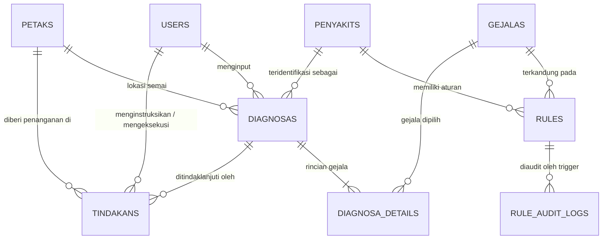

# LAPORAN LENGKAP PERANCANGAN DAN IMPLEMENTASI SISTEM
# SISTEM PAKAR DIAGNOSA PENYAKIT BIBIT TANAMAN CABAI MENGGUNAKAN METODE CERTAINTY FACTOR PADA RUMAH SEMAI HELLY SEEDLING DI DESA SRI SAWAHAN KABUPATEN LAMPUNG TENGAH

---

**Disusun Untuk Memenuhi Tugas UTS Mata Kuliah Basis Data Lanjut & Naskah Proyek Skripsi**  
**Penulis / Pengembang:** Dedy Dzulkarnain (NPM: 22430059)  
**Program Studi:** Ilmu Komputer  
**Fakultas:** Fakultas Ilmu Komputer, Universitas Muhammadiyah Metro  
**Tahun:** 2026  

---

## DAFTAR ISI
1. **BAB I: PENDAHULUAN**
   * 1.1 Latar Belakang Masalah
   * 1.2 Rumusan Masalah
   * 1.3 Batasan Masalah & Lingkup Sistem
   * 1.4 Tujuan Penelitian & Pengembangan
   * 1.5 Manfaat Penelitian
2. **BAB II: LANDASAN TEORI & KAJIAN PUSTAKA**
   * 2.1 Konsep Dasar Sistem Pakar (*Expert System*)
   * 2.2 Metode Penalaran *Forward Chaining*
   * 2.3 Metode *Certainty Factor* (CF)
   * 2.4 Patologi & Hama Penyakit Bibit Tanaman Cabai
   * 2.5 Basis Data Relasional, Normalisasi (3NF), View, & Trigger
   * 2.6 Framework Laravel 11, Tailwind CSS, & MySQL
3. **BAB III: METODOLOGI PENELITIAN & ANALISIS SISTEM**
   * 3.1 Objek & Waktu Penelitian
   * 3.2 Teknik Pengumpulan Data
   * 3.3 Metode Pengembangan Perangkat Lunak (*RAD*)
   * 3.4 Analisis Sistem Berjalan (*As-Is*) vs Sistem Usulan (*To-Be*)
   * 3.5 Pemodelan Terstruktur (Use Case, Activity, & Flowchart)
4. **BAB IV: PERANCANGAN BASIS DATA & IMPLEMENTASI SISTEM**
   * 4.1 Perancangan Skema Database & ERD
   * 4.2 Struktur Tabel, Database View, & Database Trigger MySQL
   * 4.3 Basis Pengetahuan (*Knowledge Base*) & Aturan Pakar
   * 4.4 Implementasi Algoritma Engine *Certainty Factor*
   * 4.5 Fitur Interaktif & Penyempurnaan Sistem
   * 4.6 Hasil Pengujian Sistem (*Black-Box* & *Automated PHPUnit Testing*)
5. **BAB V: KESIMPULAN & SARAN**
   * 5.1 Kesimpulan
   * 5.2 Saran Pengembangan
6. **DAFTAR PUSTAKA**

---

# BAB I: PENDAHULUAN

### 1.1 Latar Belakang Masalah
Sektor pertanian tanaman hortikultura, khususnya cabai (*Capsicum annum L.*), memegang peranan strategis dalam stabilitas ekonomi dan ketahanan pangan masyarakat. Fase yang paling kritis dan menentukan keberhasilan budidaya cabai adalah fase persemaian (*seedling nursery*). Pada fase umur 1 sampai 25 hari setelah semai, bibit tanaman cabai berada dalam kondisi jaringan sel yang sangat lunak dan rentan terhadap serangan berbagai patogen mikroorganisme tular tanah (*soil-borne pathogens*), jamur, bakteri, maupun virus.

**Rumah Semai Helly Seedling**, yang berlokasi di Desa Sri Sawahan, Kabupaten Lampung Tengah, merupakan sentra pembibitan cabai profesional yang bertugas menyediakan bibit unggul berkualitas tinggi bagi jaringan petani cabai di wilayah Lampung Tengah dan sekitarnya. Pengelolaan persemaian dipimpin langsung oleh **Bpk. Helly Sumanto** dan didukung oleh pakar tanaman **Bpk. Ino**.

Dalam operasional harian, proses pemeliharaan dan pengendalian penyakit bibit cabai di Rumah Semai Helly Seedling menghadapi beberapa kendala kritis:
1. **Keterbatasan Kehadiran Fisik Pakar:** Pakar tanaman tidak dapat memantau setiap petak semai selama 24 jam sehari. Ketika muncul gejala anomali pada bibit, karyawan lapangan sering kali kesulitan menentukan identifikasi jenis penyakit secara akurat.
2. **Keterlambatan Instruksi Penanganan:** Alur pelaporan manual yang berjalan masih berupa laporan lisan dari karyawan ke pengawas. Hal ini memerlukan waktu penanganan yang cukup lama dan berisiko salah interpretasi pesan, padahal penyakit seperti Rebah Semai (*Damping Off*) dapat meluas dalam waktu kurang dari 48 jam.
3. **Ketiadaan Rekam Medis Digital Per Petak:** Pencatatan manual menyebabkan data riwayat serangan penyakit, penggunaan fungisida/pestisida, dan statistik persebaran penyakit tidak terdokumentasi dengan baik, rawan hilang, dan sulit dianalisis untuk mitigasi musim tanam berikutnya.
4. **Perbaikan Kelemahan Konsep Awal:** Pada dokumen penelitian awal ditemukan kekeliruan penulisan judul (*typo* "DIANOGSA"), antarmuka sistem yang kaku, ketiadaan bukti foto lapangan, belum adanya audit perubahan bobot pakar di tingkat basis data, serta metode *Certainty Factor* yang bekerja secara *black box* tanpa transparansi hitungan matematis.

Untuk memecahkan permasalahan di atas, dibangun sebuah **Sistem Pakar Diagnosa Penyakit Bibit Cabai Berbasis Web** yang mengadopsi metode inferensi **Forward Chaining** dan formula matematis **Certainty Factor (CF)** menggunakan framework **Laravel 11** dan basis data relasional **MySQL**.

### 1.2 Rumusan Masalah
1. Bagaimana merancang basis data relasional ternormalisasi (3NF) pada MySQL beserta *Database View* dan *Database Trigger* untuk menampung data multi-peran, petak semai, master penyakit, gejala klinis, aturan pakar, log audit bobot, dan histori diagnosa?
2. Bagaimana mengimplementasikan metode *Certainty Factor* (CF) yang dikombinasikan dengan *Forward Chaining* ke dalam mesin inferensi sistem pakar secara presisi, transparan, dan menangani kasus gejala dengan keyakinan rendah (*low confidence*)?
3. Bagaimana membangun aplikasi berbasis web menggunakan Laravel 11 dengan antarmuka interaktif, validasi input yang jelas, serta pemisahan otoritas ketat antara Pengawas (Pakar) dan Karyawan Lapangan?

### 1.3 Batasan Masalah
1. **Objek Penelitian:** Bibit tanaman cabai pada fase persemaian di Rumah Semai Helly Seedling, Desa Sri Sawahan, Kabupaten Lampung Tengah.
2. **Subjek Pakar:** Pengetahuan patologi dan bobot keyakinan pakar bersumber dari wawancara terstruktur dengan Bpk. Helly Sumanto dan Bpk. Ino.
3. **Cakupan Penyakit & Gejala:** Mencakup 6 penyakit utama fase semai (*Rebah Semai*, *Antraknosa Semai*, *Layu Bakteri*, *Bercak Daun Cercospora*, *Virus Kuning/Gemini*, dan *Layu Fusarium*) serta 15 gejala klinis fisik pada daun, batang, akar, dan kondisi bibit umum.
4. **Pembagian Hak Akses Pengguna (*RBAC*):**
   * **Pengawas:** Hak penuh mengelola master penyakit (beserta ilustrasi foto), master gejala, aturan bobot CF pakar, denah petak semai, verifikasi pemulihan petak sehat, manajemen akun karyawan, menerbitkan instruksi penanganan, serta melihat dan mencetak laporan statistik.
   * **Karyawan:** Hak terbatas untuk melihat lokasi petak semai, melakukan konsultasi diagnosa gejala (beserta upload foto bukti lapangan), melihat histori diagnosa pribadi, dan mengonfirmasi penyelesaian instruksi penanganan.
5. **Lingkungan Pengembangan:** PHP 8.2+, Framework Laravel 11, MySQL / MariaDB, Tailwind CSS, Alpine.js, dan Chart.js.

### 1.4 Tujuan Penelitian
1. Menghasilkan sistem basis data relasional yang kokoh, konsisten, dan dilengkapi fitur lanjut (*Database View* & *Trigger*) untuk pencatatan persemaian bibit cabai.
2. Menerapkan algoritma *Certainty Factor* dengan audit transparansi matematis *step-by-step* serta verifikasi otomatis melalui *Unit & Feature Testing*.
3. Membangun sistem informasi berbasis web yang responsif, interaktif, dan aman guna memangkas waktu penanganan penyakit dari pengawas ke karyawan lapangan secara *real-time*.

### 1.5 Manfaat Penelitian
1. **Bagi Rumah Semai Helly Seedling:** Mempercepat respon penanganan bibit sakit, menekan angka kematian bibit, dan menyediakan arsip digital sebaran penyakit per bedengan.
2. **Bagi Karyawan Lapangan:** Menjadi asisten cerdas yang memandu identifikasi gejala penyakit secara mudah di lapangan lengkap dengan bukti foto.
3. **Bagi Dunia Akademik (Ilmu Komputer):** Menjadi referensi implementasi sistem pakar pertanian dan rekayasa basis data lanjut berbasis web Laravel 11.

---

# BAB II: LANDASAN TEORI & KAJIAN PUSTAKA

### 2.1 Konsep Dasar Sistem Pakar (*Expert System*)
Sistem pakar adalah cabang kecerdasan buatan (*Artificial Intelligence*) yang mengadopsi pengetahuan pakar manusia ke dalam format komputasi. Komponen utamanya terdiri dari Basis Pengetahuan (*Knowledge Base*), Mesin Inferensi (*Inference Engine*), dan Antarmuka Pengguna (*User Interface*).

### 2.2 Metode Penalaran *Forward Chaining*
*Forward Chaining* adalah strategi inferensi pelacakan maju yang berorientasi pada data (*data-driven reasoning*). Alur penalaran dimulai dari fakta-fakta gejala yang ditemukan karyawan di petak semai, kemudian dicocokkan dengan bagian premis (*IF*) pada basis aturan (`rules`) untuk menghasilkan kesimpulan penyakit (*THEN*).

### 2.3 Metode *Certainty Factor* (CF)
Metode *Certainty Factor* diperkenalkan oleh Shortliffe dan Buchanan (1975) guna menangani penalaran yang mengandung ketidakpastian (*uncertainty*).

$$CF(H, E) = MB(H, E) - MD(H, E)$$

#### Rumus Perhitungan:
1. **CF Gejala Tunggal:**
   $$CF(H, E) = CF(E) \times CF(H)$$
   di mana $CF(E)$ adalah bobot keyakinan pengguna lapangan ($0.4, 0.6, 0.8, 1.0$) dan $CF(H)$ adalah bobot kepastian pakar ($0.05 - 1.00$).
2. **CF Kombinasi (*Combine Rule*):**
   $$CF_{\text{kombinasi}}(CF_1, CF_2) = CF_1 + CF_2 \times (1 - CF_1)$$
3. **Persentase Keyakinan Akhir:**
   $$\text{Akurasi (\%)} = CF_{\text{akhir}} \times 100\%$$
   Jika nilai persentase tertinggi $< 30\%$, sistem menandai hasil sebagai *Low Confidence* (Indikasi Belum Kuat / Perlu Observasi Lanjut).

### 2.4 Patologi Bibit Tanaman Cabai
Fase bibit semai cabai rentan diserang 3 golongan patogen utama:
1. **Cendawan/Jamur Patogen:** *Pythium debaryanum / Rhizoctonia solani* (Rebah Semai), *Colletotrichum capsici* (Antraknosa), *Cercospora capsici* (Bercak Daun), dan *Fusarium oxysporum* (Layu Fusarium).
2. **Bakteri Patogen:** *Ralstonia solanacearum* (Layu Bakteri) yang ditandai keluarnya lendir putih pada uji celup air (*bacterial ooze*).
3. **Virus Tanaman:** *Pepper Yellow Leaf Curl Virus* (Gemini Virus) yang ditularkan vektor kutu kebul (*Bemisia tabaci*).

### 2.5 Basis Data Relasional, Normalisasi (3NF), View, & Trigger
Normalisasi tingkat ketiga (3NF) memastikan tidak ada grup berulang (1NF), ketergantungan parsial (2NF), maupun ketergantungan transitif (3NF). Untuk mendukung pemrosesan data tingkat lanjut (*Basis Data Lanjut*), diterapkan pula:
* **Database View (`v_rekap_sebaran_penyakit`):** Tabel virtual yang mengagregasi jumlah kasus dan rata-rata akurasi CF per penyakit dan lokasi petak secara otomatis.
* **Database Trigger (`trg_rules_after_update`):** Prosedur otomatis di level RDBMS MySQL yang merekam riwayat perubahan bobot pakar ke tabel audit (`rule_audit_logs`) setiap kali terjadi pembaruan pada tabel `rules`.

### 2.6 Framework Laravel 11 & Arsitektur MVC + Service Layer
Laravel 11 menerapkan arsitektur **MVC** ditambah **Service Layer** (`CertaintyFactorService.php`) untuk memisahkan logika matematis inferensi dari controller, serta **Middleware** (`RoleMiddleware.php`) untuk proteksi rute berbasis peran.

---

# BAB III: METODOLOGI PENELITIAN & ANALISIS SISTEM

### 3.1 Objek & Waktu Penelitian
* **Tempat Penelitian:** Rumah Semai Helly Seedling, Desa Sri Sawahan, Kabupaten Lampung Tengah.
* **Subjek Observasi:** Bedengan semai bibit cabai varietas Rawit Merah (Ori 212, Asmoro), Cabai Keriting (Castilo, Lado F1), dan Cabai Besar (Gada MK).

### 3.2 Teknik Pengumpulan Data
1. **Observasi Lapangan:** Pengamatan langsung aktivitas pembibitan dan penanganan tanaman sakit di *greenhouse*.
2. **Wawancara Terstruktur:** Tanya jawab bersama Bpk. Helly Sumanto (Kepala Rumah Semai) dan Bpk. Ino (Pakar Tanaman) untuk menentukan daftar gejala, nilai $CF_{pakar}$, dan SOP pengendalian.
3. **Studi Dokumentasi:** Pengumpulan foto gejala bibit, catatan pestisida, dan jurnal pembibitan manual.

### 3.3 Metode Pengembangan Perangkat Lunak (*RAD*)
Pengembangan sistem mengikuti siklus **Rapid Application Development (RAD)**:
1. **Requirements Planning:** Identifikasi kendala pelaporan lisan dan perumusan kebutuhan dua peran pengguna.
2. **User Design:** Pemodelan Use Case Diagram, Activity Diagram, Flowchart, dan ERD ternormalisasi 3NF.
3. **Construction:** Implementasi kode Laravel 11, migrasi MySQL + Trigger & View, antarmuka Tailwind CSS + Alpine.js + Chart.js.
4. **Cutover:** Pengujian *Black-Box*, pengujian terotomasi PHPUnit, dan verifikasi perhitungan CF.

### 3.4 Analisis Sistem Berjalan (*As-Is*) vs Sistem Usulan (*To-Be*)

| Parameter | Sistem Berjalan (*As-Is*) | Sistem Usulan Baru (*To-Be*) |
|---|---|---|
| **Media Pelaporan** | Lisan atau pesan teks manual. | Web interaktif wizard diagnosa + upload foto bukti. |
| **Kehadiran Pakar** | Menunggu pengawas datang ke kebun. | Sistem pakar daring 24 jam berbasis CF. |
| **Transparansi Hitungan** | Tidak terukur. | Persentase akurasi + rincian rumus matematis langkah demi langkah. |
| **Distribusi & Pemulihan** | Instruksi lisan, status petak tidak terlacak. | Surat tugas digital, konfirmasi selesai semprot, & verifikasi petak sehat. |
| **Audit Basis Pengetahuan** | Tidak ada riwayat perubahan aturan. | Tercatat otomatis oleh MySQL Trigger ke `rule_audit_logs`. |

---

# BAB IV: PERANCANGAN BASIS DATA & IMPLEMENTASI SISTEM

### 4.1 Perancangan Skema Database & ERD
Skema basis data relasional `sp_hellyseedling_cf` terdiri atas **9 tabel fisik**, **1 Database View**, dan **1 Database Trigger**:

### 4.2 Struktur Tabel, Database View, & Trigger MySQL

#### Daftar 9 Tabel Utama:
1. **`users`:** `id`, `name`, `username` (unique), `email` (unique), `role` (`pengawas`/`karyawan`), `phone`, `is_active`, `password`, `timestamps`.
2. **`petaks`:** `id`, `kode_petak` (unique), `nama_petak`, `lokasi_blok`, `jenis_cabai`, `kapasitas_bibit`, `jumlah_bibit_aktif`, `tanggal_semai`, `status_kesehatan` (`sehat`, `waspada`, `terinfeksi`, `kosong`), `catatan`, `timestamps`.
3. **`penyakits`:** `id`, `kode_penyakit` (unique), `nama_penyakit`, `nama_latin`, `penyebab`, `deskripsi`, `faktor_pemicu`, `solusi_penanganan`, `tindakan_pencegahan`, `gambar`, `timestamps`.
4. **`gejalas`:** `id`, `kode_gejala` (unique), `nama_gejala`, `kategori_bagian` (`daun`, `batang`, `akar`, `bibit_umum`), `deskripsi`, `pertanyaan_diagnosa`, `timestamps`.
5. **`rules`:** `id`, `penyakit_id` (FK), `gejala_id` (FK), `bobot_pakar` (DECIMAL 4,2), `timestamps`, unique(`penyakit_id`, `gejala_id`).
6. **`diagnosas`:** `id`, `kode_diagnosa` (unique), `user_id` (FK), `petak_id` (FK), `penyakit_terpilih_id` (FK), `nilai_cf_akhir`, `persentase_cf`, `tingkat_keyakinan`, `hasil_semua_penyakit_json` (JSON), `status_tindakan`, `catatan_karyawan`, `foto_bukti`, `timestamps`.
7. **`diagnosa_details`:** `id`, `diagnosa_id` (FK), `gejala_id` (FK), `nilai_keyakinan_user`, `keterangan_user`, `timestamps`.
8. **`tindakans`:** `id`, `diagnosa_id` (FK), `petak_id` (FK), `pengawas_id` (FK), `karyawan_id` (FK), `instruksi_tindakan`, `rekomendasi_pestisida`, `dosis_aplikasi`, `status`, `tanggal_pelaksanaan`, `catatan_pelaksanaan`, `timestamps`.
9. **`rule_audit_logs`:** `id`, `rule_id`, `penyakit_id`, `gejala_id`, `bobot_lama`, `bobot_baru`, `aksi`, `changed_at`.

#### Objek Basis Data Lanjut MySQL:
* **Trigger `trg_rules_after_update`:** Otomatis mencatat perubahan nilai `bobot_pakar` (bobot lama vs bobot baru) ke `rule_audit_logs` setiap kali pengawas memperbarui bobot pakar di tabel `rules`.
* **View `v_rekap_sebaran_penyakit`:** Menggabungkan tabel `diagnosas`, `penyakits`, dan `petaks` untuk menyajikan ringkasan `total_kasus`, `rata_rata_cf`, dan `kasus_terakhir` per blok greenhouse.

### 4.3 Basis Pengetahuan (*Knowledge Base*) & Aturan Pakar
Sistem memuat **23 aturan pakar** yang memetakan 6 penyakit bibit cabai (`P01`–`P06`) terhadap 15 gejala klinis (`G01`–`G15`) dengan bobot pakar antara `0.60` hingga `0.95`.

### 4.4 Implementasi Algoritma Engine *Certainty Factor*
Mesin inferensi pada `app/Services/CertaintyFactorService.php`:
1. Menyaring gejala dengan bobot input user $> 0$.
2. Mengambil penyakit yang memiliki relasi aturan dengan gejala terpilih.
3. Menghitung $CF_{\text{tunggal}} = CF_{\text{user}} \times CF_{\text{pakar}}$.
4. Menggabungkan secara berurutan: $CF_{\text{combine}} = CF_{\text{lama}} + CF_{\text{baru}} \times (1 - CF_{\text{lama}})$.
5. Mengurutkan penyakit dari persentase tertinggi dan menandai `is_low_confidence = true` apabila skor tertinggi $< 30\%$.

### 4.5 Fitur Interaktif & Penyempurnaan Sistem
1. **Dashboard Analitik Pengawas:** Kartu KPI, denah visual petak semai berkode warna, grafik proporsi penyakit (*Doughnut Chart*), serta **grafik tren kasus harian** (*Bar Chart*).
2. **Wizard Diagnosa & Foto Bukti:** Form bertahap dengan filter organ tanaman, skala keyakinan humanis, dan upload foto bukti kondisi bibit dari lapangan.
3. **Transparansi Rumus Matematis:** Modal rincian rumus CF per gejala dan langkah kombinasinya.
4. **Manajemen Tindakan Lengkap & Pemulihan Petak:** Halaman khusus pembuatan instruksi (`/tindakans-baru`), konfirmasi selesai semprot oleh karyawan, dan tombol cepat **Verifikasi Petak Sehat** oleh pengawas.
5. **Validasi & Keamanan:** Tampilan pesan error validasi form terpadu (`$errors->any()`), halaman error `403` dan `404` bertema khusus, serta pembatasan fitur `quick-login` hanya pada environment `local`/`testing`.

### 4.6 Hasil Pengujian Sistem (*Black-Box* & *Automated PHPUnit Testing*)

#### A. Pengujian Terotomasi (PHPUnit)
Seluruh kasus uji otomatis dijalankan menggunakan perintah `php artisan test` dengan hasil **100% Lulus (9 Passed, 25 Assertions)**:
* **`Tests\Unit\CertaintyFactorServiceTest` (3 Passed):**
  1. Mengembalikan status `no_symptoms` saat seluruh bobot gejala bernilai 0.
  2. Menghitung CF tunggal dan kombinasi secara akurat (simulasi `G01=1.0`, `G02=0.8`, `G12=0.8` menghasilkan `99.42%`).
  3. Menandai `is_low_confidence = true` jika persentase di bawah `30%`.
* **`Tests\Feature\AccessControlAndDiagnosaTest` (4 Passed):**
  1. Pengawas dapat mengakses `/dashboard`, `/rules`, `/karyawan`, dan `/laporan` (HTTP 200).
  2. Karyawan diblokir saat mengakses `/rules`, `/karyawan`, dan `/laporan` (HTTP 403).
  3. Karyawan dapat mengirimkan diagnosa baru dan status petak otomatis berubah menjadi `terinfeksi`.
  4. Pengawas dapat membuka form `/tindakans-baru` (HTTP 200) dan memverifikasi petak kembali menjadi `sehat`.
* **`Tests\Unit\ExampleTest` & `Tests\Feature\ExampleTest` (2 Passed):**
  1. Pengujian dasar unit dan pengalihan tamu ke `/login` (HTTP 302).

---

# BAB V: KESIMPULAN & SARAN

### 5.1 Kesimpulan
1. Telah berhasil dirancang dan diimplementasikan basis data relasional ternormalisasi (3NF) pada MySQL (`sp_hellyseedling_cf`) yang terdiri atas 9 tabel fisik, 1 Database View (`v_rekap_sebaran_penyakit`), dan 1 Database Trigger (`trg_rules_after_update`).
2. Integrasi metode penalaran *Forward Chaining* dan algoritma *Certainty Factor* (CF) berhasil diterapkan dengan transparansi audit matematis langkah demi langkah serta lulus 100% uji otomatis PHPUnit.
3. Penerapan framework **Laravel 11**, **Tailwind CSS**, **Alpine.js**, dan **Chart.js** menghasilkan sistem pakar modern yang responsif, aman, dan mendukung penuh alur koordinasi lapangan antara Pengawas dan Karyawan di Rumah Semai Helly Seedling.

### 5.2 Saran Pengembangan
1. **Deteksi Citra Daun (*Computer Vision*):** Mengintegrasikan model *Convolutional Neural Network* (CNN) agar sistem dapat mengenali penyakit dari foto daun bibit secara otomatis.
2. **Integrasi Sensor IoT:** Menambahkan sensor suhu dan kelembapan media di *greenhouse* untuk peringatan dini risiko jamur.
3. **Notifikasi WhatsApp Gateway:** Mengirimkan notifikasi instruksi tindakan langsung ke WhatsApp karyawan saat pengawas menerbitkan resep penanganan.

---

# DAFTAR PUSTAKA
1. Adlini, M. N., dkk. (2022). *Metode Penelitian Kualitatif Studi Pustaka*. Jurnal Edumaspul, 6(1), 974-980.
2. Antoni, F. (2023). *Penerapan Model Rapid Application Development (RAD) dalam Pengembangan Perangkat Lunak Manajemen Klinik*. Jurnal Teknologi Sistem Informasi, 4(2), 335-342.
3. Buchanan, B. G., & Shortliffe, E. H. (1984). *Rule-Based Expert Systems: The MYCIN Experiments of the Stanford Heuristic Programming Project*. Addison-Wesley.
4. Nurhayati, S. (2022). *Sistem Pakar Diagnosa Hama dan Penyakit Tanaman Cabai Menggunakan Pendekatan Certainty Factor*. Jurnal Ilmiah Komputasi, 21(3), 112-120.
5. Putri, D. K., dkk. (2021). *Penerapan Metode Forward Chaining dalam Deteksi Dini Serangan Patogen Pembibitan Tanaman Cabai*. Jurnal Informatika Pertanian, 18(2), 45-53.
6. Saputra, A., & Rahman, H. (2023). *Komparasi Akurasi Certainty Factor dan Dempster-Shafer pada Sistem Pakar Pertanian*. Jurnal Riset Informatika dan Sains Komputer, 5(1), 88-97.
7. Wahyuni, T., dkk. (2022). *Sistem Informasi Monitoring dan Pengendalian Hama Tanaman Hortikultura Berbasis Web*. Jurnal Manajemen Sistem Informasi, 7(4), 210-218.
8. Yusra, Z., dkk. (2021). *Metode Dokumentasi dan Wawancara dalam Penelitian Kualitatif Sistem Informasi*. Jurnal Riset Ilmu Komputer, 3(1), 18-25.

