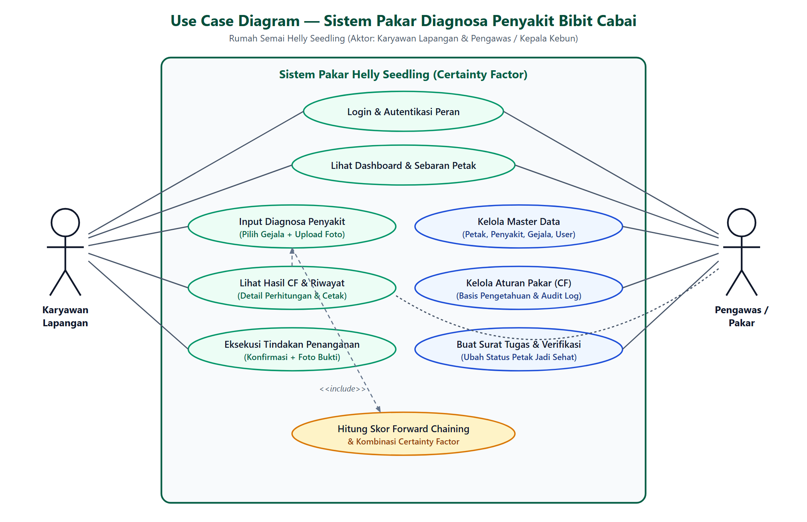
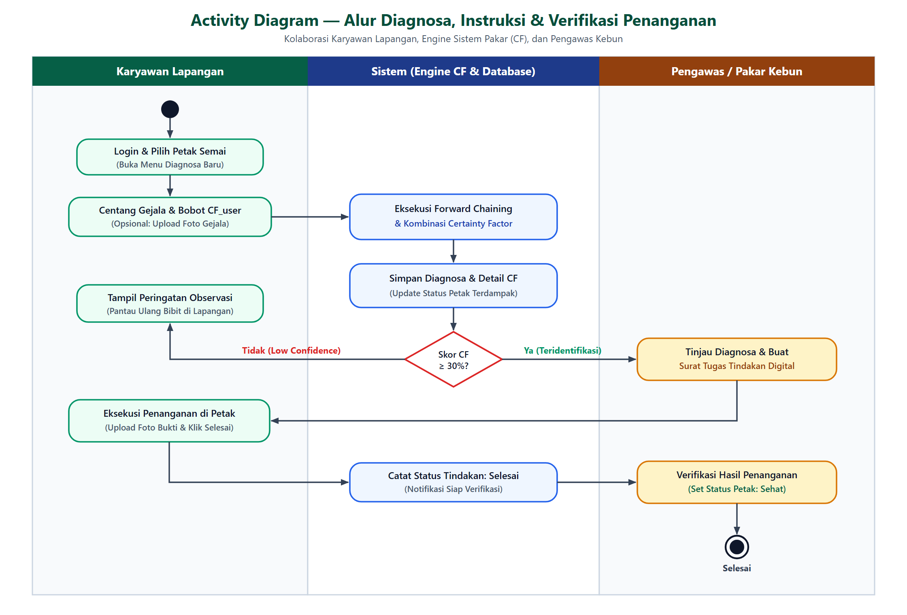
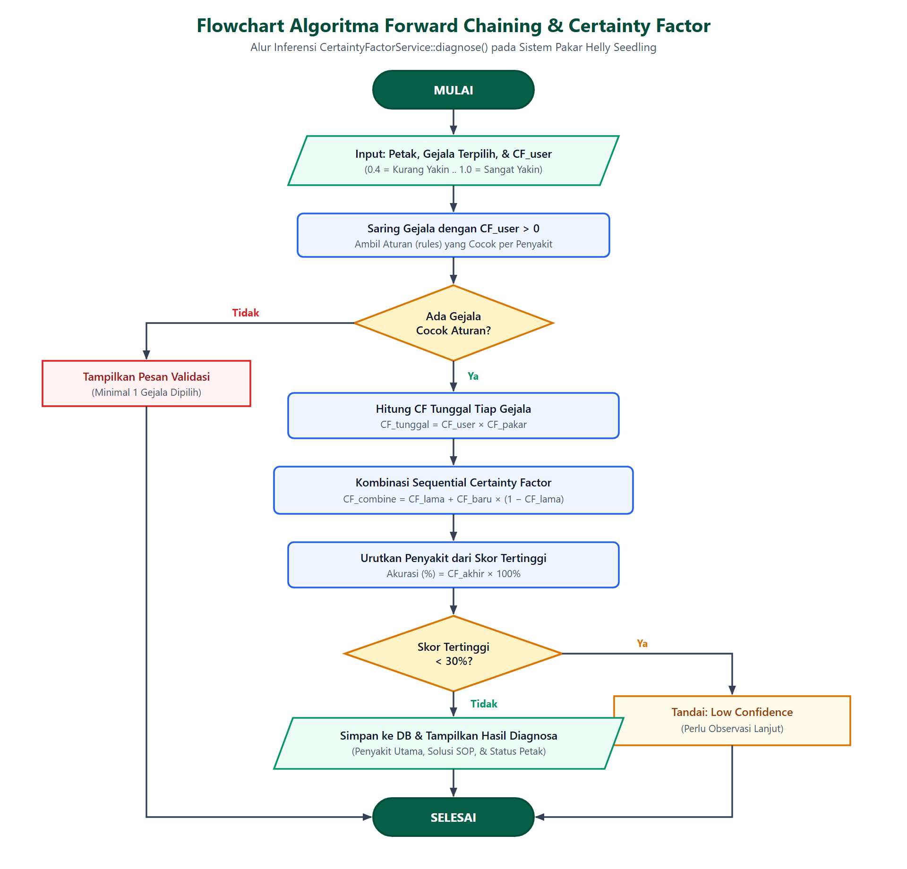
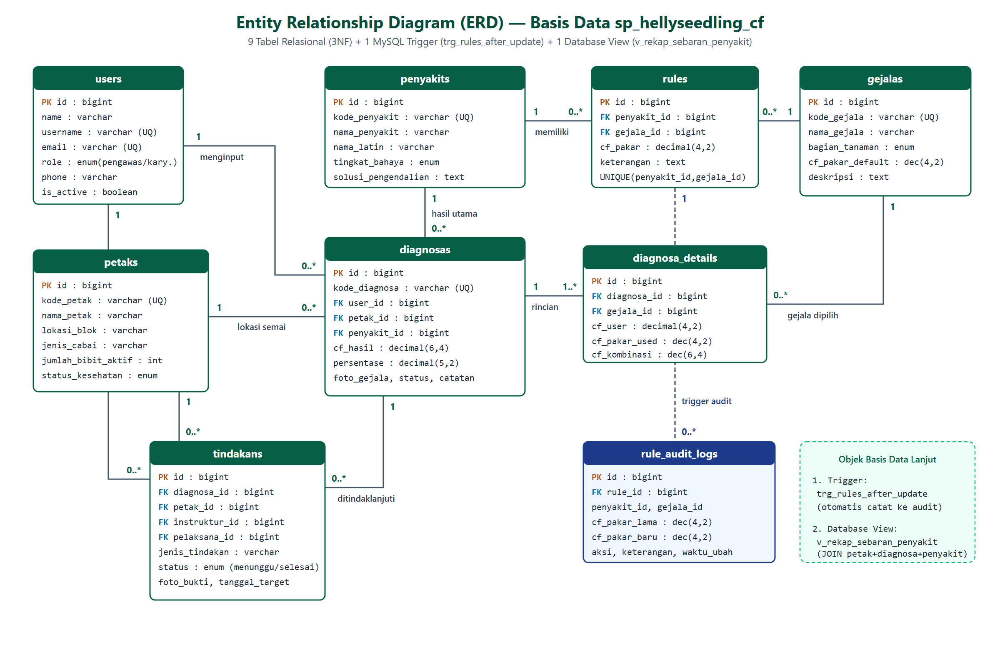

# 🌶️ Sistem Pakar Diagnosa Penyakit Bibit Cabai (Certainty Factor)
### Rumah Semai Helly Seedling — Desa Sri Sawahan, Lampung Tengah


---

## 📌 Ringkasan Proyek

Sistem Pakar Diagnosa Penyakit Bibit Tanaman Cabai ini dikembangkan berbasis web untuk membantu operasional rumah semai **Helly Seedling** di Desa Sri Sawahan, Kec. Punggur, Kab. Lampung Tengah. Sistem ini menerapkan metode inferensi **Forward Chaining** yang dipadukan dengan perhitungan derajat kepastian **Certainty Factor (CF)** untuk mendiagnosis 5 jenis penyakit krusial pada bibit cabai secara presisi, menyajikan SOP penanganan cepat, mengelola surat tugas tindakan semprot/isolasi, dan memantau status kesehatan seluruh petak semai secara *real-time*.

---

## 👨‍💻 Identitas Pengembang & Proyek

* **Penyusun:** Dedy Dzulkarnain (NPM: 22430059)
* **Program Studi:** S1 Ilmu Komputer, Fakultas Ilmu Komputer, Universitas Muhammadiyah Metro
* **Mata Kuliah:** Basis Data Lanjut (UTS) & Naskah Proyek Skripsi
* **Narasumber Pakar:** Bpk. Helly Sumanto (Kepala Rumah Semai) & Bpk. Ino (Pakar Tanaman)
* **Dokumen Lengkap:** 
  * 📥 **[Download File Word (.docx)](docs/laporan/LAPORAN_LENGKAP_SISTEM_PAKAR.docx)** *(Format Standar Skripsi A4 + 4 Diagram Lengkap)*
  * 📄 **[Baca Laporan Markdown (.md)](docs/laporan/LAPORAN_LENGKAP_SISTEM_PAKAR.md)**
  * 📁 **[Jelajahi Folder Dokumen Laporan](docs/laporan/)**

---

## ✨ Fitur-Fitur Utama

1. **Role-Based Access Control (RBAC):**
   * **Pengawas / Pakar Kebun:** Akses penuh ke seluruh menu (Dashboard, Master Petak Semai, Master Penyakit & Gejala, Aturan Basis Pengetahuan & CF Pakar, Audit Log Perubahan Aturan, Riwayat Diagnosa, serta Penerbitan Surat Tugas Tindakan & Verifikasi Pemulihan Petak).
   * **Karyawan Lapangan:** Akses operasional lapangan (Dashboard sebaran, Form Konsultasi Diagnosa Mandiri + Upload Foto Gejala, Riwayat Pribadi, serta Pelaksanaan Surat Tugas Tindakan + Upload Bukti Penanganan).
2. **Engine Inferensi Forward Chaining & Certainty Factor:**
   * Menghitung nilai kombinasi $CF$ secara akurat berdasarkan input keyakinan pengguna lapangan ($CF_{user}$) dan bobot kepastian pakar ($CF_{pakar}$).
   * Indikator *Low Confidence* otomatis apabila persentase keyakinan tertinggi $< 30\%$ (mewajibkan observasi lapangan lanjutan sebelum aplikasi fungisida/bakterisida).
3. **Audit Log Perubahan Aturan (Database Trigger):**
   * Perekaman otomatis histori perubahan bobot CF aturan menggunakan MySQL Trigger `trg_rules_after_update` ke tabel `rule_audit_logs`.
4. **Monitoring Sebaran Penyakit (Database View):**
   * Agregasi data petak, diagnosa, dan sebaran penyakit menggunakan MySQL View `v_rekap_sebaran_penyakit`.
5. **Workflow Tindakan Lapangan (Closed-Loop):**
   * Siklus lengkap penanganan: `Petak Terinfeksi` $\rightarrow$ `Diagnosa Terbit` $\rightarrow$ `Surat Tugas Diterbitkan Pengawas` $\rightarrow$ `Karyawan Melakukan Tindakan & Upload Foto Bukti` $\rightarrow$ `Pengawas Memverifikasi & Mengubah Status Petak Kembali Menjadi Sehat`.
6. **Ekspor & Cetak Laporan:**
   * Fitur cetak langsung hasil diagnosa dalam format PDF/Print-ready yang rapi.
7. **One-Command Launcher (`gas`):**
   * Menjalankan daemon MySQL dan Laravel server sekaligus hanya dengan mengetik `gas` di terminal.

---

## 🧮 Metodologi & Rumus Certainty Factor

Sistem menggunakan formula standar Certainty Factor (Shortliffe & Buchanan) untuk mengkuantifikasi ketidakpastian diagnosa:

1. **Kaidah Dasar CF:**
   $$CF(H, E) = MB(H, E) - MD(H, E)$$
2. **CF Gejala Tunggal:**
   $$CF_{tunggal} = CF(E) \times CF(H)$$
   * $CF(E)$ = Bobot keyakinan pengguna ($0.4 = \text{Kurang Yakin}, 0.6 = \text{Cukup Yakin}, 0.8 = \text{Yakin}, 1.0 = \text{Sangat Yakin}$).
   * $CF(H)$ = Bobot kepastian pakar tanaman ($0.05 - 1.00$).
3. **Kombinasi CF Gejala Majemuk (Sequential Combine):**
   $$CF_{kombinasi}(CF_1, CF_2) = CF_1 + CF_2 \times (1 - CF_1)$$
4. **Persentase Keyakinan Akhir:**
   $$\text{Akurasi (\%)} = CF_{akhir} \times 100\%$$

---

## 🌿 Data Penyakit & Gejala Bibit Cabai

| Kode | Nama Penyakit | Nama Latin / Patogen | Tingkat Bahaya | Jumlah Aturan |
|:---:|:---|:---|:---:|:---:|
| **P01** | Rebah Semai (*Damping-Off*) | *Pythium debaryanum / Rhizoctonia solani* | Kritis | 4 Gejala |
| **P02** | Antraknosa Semai | *Colletotrichum capsici* | Tinggi | 4 Gejala |
| **P03** | Layu Bakteri | *Ralstonia solanacearum* | Kritis | 4 Gejala |
| **P04** | Virus Kuning / Gemini (*Bule*) | *Pepper Yellow Leaf Curl Virus (PepYLCV)* | Sedang | 3 Gejala |
| **P05** | Bercak Daun Cercospora | *Cercospora capsici* | Sedang | 4 Gejala |

*Total Gejala Basis Pengetahuan:* **16 Gejala Spesifik** (G01–G16) dengan bobot $CF_{pakar}$ terkalibrasi.

---

## 📊 Diagram Pemodelan Sistem

### 1. Use Case Diagram
Menggambarkan batasan sistem dan interaksi antara peran Karyawan Lapangan serta Pengawas / Pakar Kebun:
<p align="center">
  
</p>

### 2. Activity Diagram
Alur kerja kolaboratif proses konsultasi diagnosa, penerbitan surat tugas tindakan, dan verifikasi status petak:
<p align="center">
  
</p>

### 3. Flowchart Algoritma Engine Certainty Factor
Logika eksekusi inferensi pada service layer `CertaintyFactorService::diagnose()`:
<p align="center">
  
</p>

### 4. Entity Relationship Diagram (ERD)
Struktur 9 tabel relasional (3NF), 1 MySQL Trigger, dan 1 Database View pada database `sp_hellyseedling_cf`:
<p align="center">
  
</p>

---

## 📸 Tangkapan Layar Aplikasi (Screenshots)

Berikut adalah antarmuka antarmuka utama implementasi sistem:

### 1. Halaman Autentikasi / Login
Antarmuka login dengan fitur *Quick Login (1-Click)* untuk Pengawas dan Karyawan Lapangan:
<p align="center">
  
</p>

### 2. Dashboard & Panel Pengawas (Pakar)
Panel kendali komprehensif bagi pengawas kebun mencakup statistik sebaran petak terinfeksi, verifikasi tindakan penanganan, dan manajemen basis pengetahuan:
<p align="center">
  
</p>

### 3. Dashboard & Panel Karyawan Lapangan
Antarmuka operasional karyawan lapangan untuk melakukan konsultasi diagnosa penyakit mandiri, pemilihan gejala berbobot keyakinan, dan upload bukti tindakan:
<p align="center">
  
</p>

---

## 🗄️ Struktur Basis Data Lanjut (MySQL)

### Daftar 9 Tabel Fisik
1. `users` — Akun pengguna dengan diferensiasi peran (`pengawas` / `karyawan`) dan status aktif.
2. `petaks` — Data master petak semai, kapasitas, jumlah bibit, dan status kesehatan (`sehat`, `waspada`, `terinfeksi`, `kosong`).
3. `penyakits` — Data patologi penyakit bibit cabai, nama latin, tingkat bahaya, dan SOP penanganan.
4. `gejalas` — Master 16 gejala bibit cabai, kategori bagian tanaman, dan bobot default pakar.
5. `rules` — Aturan basis pengetahuan pakar (relasi many-to-many `penyakit_id` & `gejala_id`) dengan nilai `cf_pakar`.
6. `diagnosas` — Header riwayat diagnosa per petak, hasil penyakit utama, skor CF akhir, dan foto gejala.
7. `diagnosa_details` — Detail tiap gejala yang dipilih, nilai $CF_{user}$, $CF_{pakar}$, dan $CF_{kombinasi}$ per tahap.
8. `tindakans` — Surat tugas digital pengendalian penyakit, instruktur, pelaksana, tanggal target, foto bukti, dan status.
9. `rule_audit_logs` — Tabel histori pencatatan audit perubahan aturan basis pengetahuan.

### MySQL Trigger (`trg_rules_after_update`)
```sql
CREATE TRIGGER trg_rules_after_update
AFTER UPDATE ON rules
FOR EACH ROW
BEGIN
    IF OLD.cf_pakar <> NEW.cf_pakar THEN
        INSERT INTO rule_audit_logs (
            rule_id, penyakit_id, gejala_id,
            cf_pakar_lama, cf_pakar_baru,
            aksi, keterangan, created_at, updated_at
        ) VALUES (
            OLD.id, OLD.penyakit_id, OLD.gejala_id,
            OLD.cf_pakar, NEW.cf_pakar,
            'UPDATE', 'Otomatis dicatat oleh Trigger MySQL trg_rules_after_update',
            NOW(), NOW()
        );
    END IF;
END;
```

### MySQL Database View (`v_rekap_sebaran_penyakit`)
```sql
CREATE VIEW v_rekap_sebaran_penyakit AS
SELECT 
    p.id AS petak_id,
    p.kode_petak,
    p.nama_petak,
    p.lokasi_blok,
    p.jenis_cabai,
    p.status_kesehatan,
    COUNT(d.id) AS total_diagnosa,
    MAX(d.created_at) AS diagnosa_terakhir,
    py.nama_penyakit AS penyakit_terakhir,
    d.persentase AS persentase_terakhir
FROM petaks p
LEFT JOIN diagnosas d ON p.id = d.petak_id
LEFT JOIN penyakits py ON d.penyakit_id = py.id
GROUP BY p.id, p.kode_petak, p.nama_petak, p.lokasi_blok, p.jenis_cabai, p.status_kesehatan, py.nama_penyakit, d.persentase;
```

---

## 🚀 Panduan Instalasi & Menjalankan Sistem

### Prasyarat Sistem
* PHP $\ge$ 8.2 (ekstensi aktif: `pdo_mysql`, `mbstring`, `openssl`, `zip`, `xml`, `gd`)
* Composer $\ge$ 2.0
* MySQL Server / XAMPP (port default `3306`)
* Web Browser modern (Chrome / Edge / Firefox)

### Langkah Instalasi
1. **Clone repositori:**
   ```bash
   git clone https://github.com/<username>/<repo-name>.git
   cd <repo-name>
   ```

2. **Install dependensi Composer:**
   ```bash
   composer install
   ```

3. **Konfigurasi Environment (`.env`):**
   ```bash
   copy .env.example .env
   php artisan key:generate
   ```
   Pastikan konfigurasi database di file `.env` sudah sesuai:
   ```env
   DB_CONNECTION=mysql
   DB_HOST=127.0.0.1
   DB_PORT=3306
   DB_DATABASE=sp_hellyseedling_cf
   DB_USERNAME=root
   DB_PASSWORD=
   ```

4. **Migrasi Database & Seeding Data Pakar:**
   ```bash
   php artisan migrate:fresh --seed
   ```
   *Perintah ini akan membuat 9 tabel, MySQL Trigger, MySQL View, serta mengisi seluruh data pakar dan akun default.*

5. **Symlink Storage (untuk upload foto gejala & bukti tindakan):**
   ```bash
   php artisan storage:link
   ```

6. **Jalankan Aplikasi:**
   * **Cara Cepat (Launcher Terminal):**
     ```powershell
     gas
     ```
     *Launcher `gas` akan otomatis memeriksa/menjalankan daemon MySQL dan langsung membuka server Laravel di port 8000.*
   * **Cara Standar:**
     ```bash
     php artisan serve
     ```
   Buka browser dan akses: `http://localhost:8000`

---

## 🔑 Kredensial Akun Default

| Peran | Username | Password | Hak Akses |
|:---|:---|:---|:---|
| **Pengawas (Pakar)** | `pengawas` | `password` | Akses Penuh: Kelola Master, Aturan CF, Audit Log, Tindakan & Verifikasi |
| **Karyawan Lapangan** | `karyawan` | `password` | Akses Lapangan: Diagnosa Mandiri, Riwayat Pribadi, Eksekusi Tindakan |

> **Catatan Pengujian:** Pada halaman login terdapat tombol *Quick Login (1-Click)* untuk mempermudah demonstrasi dan evaluasi sistem.

---

## 🧪 Pengujian Terotomasi (Automated Testing)

Sistem telah dilengkapi dengan pengujian unit dan fitur menggunakan **PHPUnit** dengan 100% kelulusan:

```bash
php artisan test
```

**Hasil Uji:**
```text
PASS  Tests\Unit\CertaintyFactorServiceTest
✓ calculate single cf returns correct product
✓ sequential combination produces correct certainty factor
✓ diagnose returns ranked diseases with low confidence flag

PASS  Tests\Feature\AccessControlAndDiagnosaTest
✓ unauthenticated user is redirected to login
✓ karyawan cannot access master rules management
✓ pengawas can access master rules management
✓ karyawan can perform diagnosis and view result

PASS  Tests\Unit\ExampleTest
✓ that true is true

PASS  Tests\Feature\ExampleTest
✓ the application returns a successful response

Tests:    9 passed (27 assertions)
Duration: 0.85s
```

---

## 📂 Struktur Direktori Proyek

```text
├── app/
│   ├── Http/Controllers/      # Controller MVC (Diagnosa, Master, Tindakan, dsb.)
│   ├── Http/Middleware/       # RoleMiddleware (pengawas / karyawan)
│   ├── Models/                # Eloquent Models (User, Petak, Penyakit, Gejala, Rule, dsb.)
│   └── Services/
│       └── CertaintyFactorService.php  # Engine inferensi CF & Forward Chaining
├── database/
│   ├── migrations/            # Skema 9 tabel, View, dan Trigger MySQL
│   └── seeders/               # HellySeedlingSeeder (Data pakar, master gejala, rules)
├── docs/
│   └── diagrams/              # Asset visual diagram (ERD, Use Case, Activity, Flowchart)
├── public/                    # Entry point aplikasi web
├── resources/views/           # Blade templates dengan Tailwind CSS
├── routes/
│   └── web.php                # Definisi route & proteksi middleware RBAC
├── tests/                     # Unit & Feature test suites (PHPUnit)
├── gas.bat / gas.ps1          # Script launcher satu perintah "gas"
└── README.md                  # Dokumentasi utama GitHub
```

---

## 📜 Lisensi & Hak Cipta

Proyek ini dikembangkan untuk keperluan akademik dan penerapan teknologi pada operasional Rumah Semai Helly Seedling.
Dilisensikan di bawah [MIT License](LICENSE).
